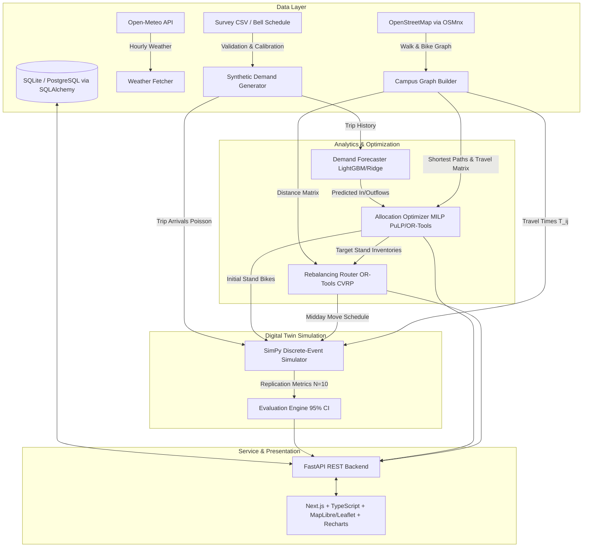

# CampusRide Planner - Architecture Specification (docs/architecture.md)

## 1. System Architecture Overview



---

## 2. Directory Layout & Module Structure

```
/mini project/
├── PROJECT_RULES.md
├── docs/
│   ├── spec.md
│   ├── architecture.md
│   ├── decisions.md
│   └── assumptions.md
├── config/
│   ├── default_config.yaml         # Fleet, stand parameters, peak hours, weights
│   ├── stands.json                 # UC Berkeley stand geographic definitions
│   └── campus_graph.graphml        # Cached OSMnx network
├── backend/
│   ├── __init__.py
│   ├── config.py                   # Pydantic settings & config loader
│   ├── db/
│   │   ├── __init__.py
│   │   ├── session.py              # SQLAlchemy engine & session factory
│   │   └── models.py               # Database ORM models
│   ├── data/
│   │   ├── __init__.py
│   │   ├── campus_graph.py         # OSMnx network extraction & matrix builder
│   │   ├── weather_fetcher.py      # Open-Meteo client with local caching
│   │   ├── survey_loader.py        # CSV survey parser & anonymizer
│   │   └── synthetic_generator.py  # NHPP Poisson trip generation engine
│   ├── forecast/
│   │   ├── __init__.py
│   │   ├── feature_pipeline.py     # Lag, calendar & weather features
│   │   └── forecaster.py           # LightGBM / Ridge + baseline comparison
│   ├── simulator/
│   │   ├── __init__.py
│   │   ├── entities.py             # Rider, Stand, Dock SimPy containers
│   │   └── engine.py               # Discrete-event execution loop
│   ├── allocation/
│   │   ├── __init__.py
│   │   └── optimizer.py            # MILP morning fleet distributor
│   ├── rebalancing/
│   │   ├── __init__.py
│   │   └── router.py               # OR-Tools CVRP service van router
│   ├── evaluation/
│   │   ├── __init__.py
│   │   └── evaluator.py            # Multi-run Monte Carlo runner & 95% CI
│   ├── api/
│   │   ├── __init__.py
│   │   ├── schemas.py              # Pydantic request & response models
│   │   ├── routes.py               # REST API endpoints
│   │   └── main.py                 # FastAPI application factory & CORS
│   └── tests/
│       ├── test_data.py
│       ├── test_forecast.py
│       ├── test_simulator.py
│       ├── test_allocation.py
│       ├── test_rebalancing.py
│       ├── test_evaluation.py
│       └── test_api.py
├── frontend/
│   ├── package.json
│   ├── tsconfig.json
│   ├── tailwind.config.js
│   ├── src/
│   │   ├── app/
│   │   │   ├── layout.tsx
│   │   │   └── page.tsx
│   │   ├── components/
│   │   │   ├── CampusMap.tsx
│   │   │   ├── StandGauge.tsx
│   │   │   ├── TimelineSlider.tsx
│   │   │   ├── MetricComparison.tsx
│   │   │   └── RebalancingPanel.tsx
│   │   └── lib/
│   │       ├── api.ts
│   │       └── types.ts
└── README.md
```

---

## 3. Data Schemas & ORM Entities

### 3.1 Database ORM Models (`backend/db/models.py`)

#### `StandModel`
- `id`: `String(16)`, Primary Key (e.g. `'ST-01'`)
- `name`: `String(64)`, Non-null
- `zone`: `String(32)` (`'Residential'`, `'Academic'`, `'Hub'`)
- `latitude`: `Float`, Non-null
- `longitude`: `Float`, Non-null
- `dock_capacity`: `Integer`, Non-null

#### `TripRecordModel`
- `id`: `Integer`, Primary Key, Autoincrement
- `request_time_sec`: `Float`, Non-null (seconds from 00:00)
- `origin_stand_id`: `String(16)`, Foreign Key to `StandModel.id`
- `dest_stand_id`: `String(16)`, Foreign Key to `StandModel.id`
- `user_type`: `String(16)` (`'student'`, `'faculty'`, `'staff'`)
- `max_wait_minutes`: `Float`, Default: 5.0
- `is_synthetic`: `Boolean`, Non-null, Default: `True`

#### `HourlyDemandModel`
- `date`: `Date`, Non-null
- `hour`: `Integer`, Non-null (0 - 23)
- `stand_id`: `String(16)`, Foreign Key to `StandModel.id`
- `pickups_actual`: `Integer`, Non-null
- `dropoffs_actual`: `Integer`, Non-null
- `temp_celsius`: `Float`, Nullable
- `precipitation_mm`: `Float`, Nullable

---

## 4. API Contracts (FastAPI Endpoints)

### 4.1 Stand Topology & Geography
- **`GET /api/v1/campus/stands`**
  - **Response**: `List[StandResponse]`
  ```json
  [
    {
      "id": "ST-01",
      "name": "Unit 1 Residence Halls",
      "zone": "Residential",
      "latitude": 37.8675,
      "longitude": -122.2555,
      "dock_capacity": 25
    }
  ]
  ```

- **`GET /api/v1/campus/matrix`**
  - **Response**:
  ```json
  {
    "stands": ["ST-01", "ST-02", "ST-03", "ST-04", "ST-05", "ST-06", "ST-07"],
    "distance_matrix_m": [[...]],
    "travel_time_matrix_sec": [[...]]
  }
  ```

### 4.2 Demand Forecast
- **`GET /api/v1/forecast/predict?date=2026-10-23`**
  - **Response**:
  ```json
  {
    "forecast_date": "2026-10-23",
    "model_name": "LightGBM_Ridge_Ensemble",
    "test_mae": 1.42,
    "baseline_mae": 2.85,
    "predictions": [
      {
        "stand_id": "ST-01",
        "hour": 8,
        "predicted_pickups": 14.2,
        "predicted_dropoffs": 2.1
      }
    ]
  }
  ```

### 4.3 Allocation Optimization
- **`POST /api/v1/allocation/optimize`**
  - **Request Body**:
  ```json
  {
    "fleet_size": 100,
    "target_hour": 7,
    "weights": { "stockout_penalty": 1.0, "overflow_penalty": 0.7 }
  }
  ```
  - **Response**:
  ```json
  {
    "fleet_size": 100,
    "baseline_allocation": { "ST-01": 15, "ST-02": 15, "ST-03": 14, "ST-04": 14, "ST-05": 14, "ST-06": 14, "ST-07": 14 },
    "optimized_allocation": { "ST-01": 24, "ST-02": 23, "ST-03": 18, "ST-04": 7, "ST-05": 9, "ST-06": 10, "ST-07": 9 },
    "objective_value": 8.35,
    "solver_status": "OPTIMAL",
    "solve_time_ms": 12.4
  }
  ```

### 4.4 Rebalancing Router
- **`POST /api/v1/rebalancing/plan`**
  - **Request Body**:
  ```json
  {
    "van_capacity": 15,
    "max_duration_minutes": 90,
    "current_inventories": { "ST-01": 2, "ST-02": 3, "ST-03": 1, "ST-04": 22, "ST-05": 25, "ST-06": 21, "ST-07": 18 },
    "target_inventories": { "ST-01": 15, "ST-02": 15, "ST-03": 12, "ST-04": 10, "ST-05": 14, "ST-06": 12, "ST-07": 10 }
  }
  ```
  - **Response**:
  ```json
  {
    "status": "FEASIBLE",
    "total_distance_km": 4.82,
    "total_time_minutes": 68.5,
    "bikes_moved": 32,
    "route_steps": [
      { "stop_order": 0, "stand_id": "DEPOT", "action": "START", "bikes_change": 0, "van_load_after": 0 },
      { "stop_order": 1, "stand_id": "ST-05", "action": "PICKUP", "bikes_change": 11, "van_load_after": 11 },
      { "stop_order": 2, "stand_id": "ST-01", "action": "DROPOFF", "bikes_change": -11, "van_load_after": 0 },
      { "stop_order": 3, "stand_id": "ST-04", "action": "PICKUP", "bikes_change": 12, "van_load_after": 12 },
      { "stop_order": 4, "stand_id": "ST-02", "action": "DROPOFF", "bikes_change": -12, "van_load_after": 0 },
      { "stop_order": 5, "stand_id": "DEPOT", "action": "END", "bikes_change": 0, "van_load_after": 0 }
    ]
  }
  ```

### 4.5 Simulation Evaluation Engine
- **`POST /api/v1/simulation/evaluate`**
  - **Request Body**:
  ```json
  {
    "replications": 10,
    "seed_base": 42,
    "fleet_size": 100
  }
  ```
  - **Response**:
  ```json
  {
    "replications": 10,
    "baseline": {
      "unmet_demand_pct": { "mean": 18.4, "ci_lower": 16.9, "ci_upper": 19.9 },
      "avg_wait_time_min": { "mean": 4.85, "ci_lower": 4.41, "ci_upper": 5.29 },
      "fleet_utilization_pct": { "mean": 38.2, "ci_lower": 36.5, "ci_upper": 39.9 }
    },
    "optimized": {
      "unmet_demand_pct": { "mean": 5.1, "ci_lower": 4.2, "ci_upper": 6.0 },
      "avg_wait_time_min": { "mean": 1.12, "ci_lower": 0.95, "ci_upper": 1.29 },
      "fleet_utilization_pct": { "mean": 52.7, "ci_lower": 50.8, "ci_upper": 54.6 }
    },
    "p_value_improvement": 0.0001
  }
  ```

---

## 5. Mathematical Formulations & Algorithms

### 5.1 Demand Generating Function
Trip arrivals between stand $i$ and stand $j$ at minute $t \in [420, 1320]$ (07:00 to 22:00) follow an inhomogeneous Poisson process:
$$\lambda_{ij}(t) = \Lambda_{\text{base}} \cdot \mathcal{T}(t) \cdot \frac{A_i^{\text{orig}} \cdot A_j^{\text{dest}}}{\sum_k A_k} \cdot \exp(-\gamma D_{ij}) \cdot \mathcal{W}(\text{temp}, \text{rain})$$
Where:
- $\mathcal{T}(t)$ is the temporal bell curve displaying surges during class change windows (:50 to :05).
- $A_i^{\text{orig}}$ is residential population weight.
- $A_j^{\text{dest}}$ is academic seat capacity.
- $\mathcal{W}$ scales demand downward during heavy rain ($\ge 2\text{ mm/h}$).

### 5.2 MILP Fleet Allocation Problem
Let binary decision variable $x_k$ be initial bikes at stand $k$:
$$\min_{x} \sum_{k=1}^K \left[ w_s \cdot \max(0, \hat{D}_k^{out} - x_k) + w_o \cdot \max(0, x_k + \hat{D}_k^{in} - C_k) \right]$$
Linearized using slack variables $u_k, v_k \ge 0$:
$$\min \sum_{k=1}^K (w_s u_k + w_o v_k)$$
Subject to:
$$u_k \ge \hat{D}_k^{out} - x_k \quad \forall k$$
$$v_k \ge x_k + \hat{D}_k^{in} - C_k \quad \forall k$$
$$\sum_{k=1}^K x_k = F$$
$$0 \le x_k \le C_k, \quad x_k \in \mathbb{Z}$$

---

## 6. Simulation Assumptions & Verification Strategy
- A dedicated document `docs/assumptions.md` stores all parameter sources.
- Unit tests run with deterministic seeds.
- Pre-flight checks ensure graph and travel matrices exist or generate deterministically.
